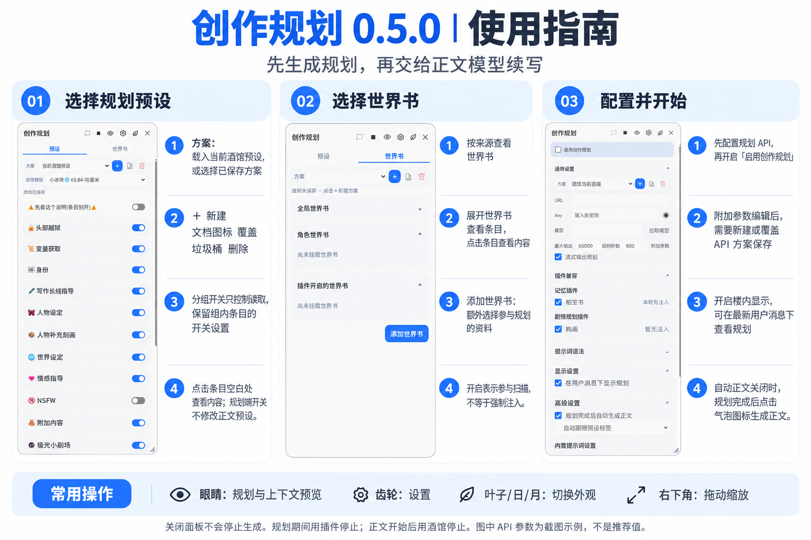

# Kế hoạch Sáng tác (Creative Planning)

Tạo độc lập kế hoạch viết cho SillyTavern, sau đó thêm kế hoạch vào yêu cầu văn bản chính (body) của lượt này. Kế hoạch và văn bản chính có thể sử dụng các API, model và preset khác nhau.

**Phiên bản hiện tại: 0.5.0.** Kho lưu trữ này là kho phát hành chính thức, bao gồm toàn bộ mã nguồn. Đã có phản hồi từ người dùng về việc tạo kế hoạch và văn bản chính thành công; các bài kiểm tra tự động và giả lập trình duyệt không thể thay thế cho việc thử nghiệm thực tế với các phiên bản SillyTavern, model và tổ hợp plugin khác nhau.

## Hình ảnh Hướng dẫn Sử dụng



[Xem ảnh hướng dẫn kích thước gốc](docs/release/creative-planning-0.5.0-guide.png). Tên preset và các chỉ số API trong ảnh chụp màn hình chỉ là ví dụ, không phải là cấu hình bắt buộc hay thông số được đề xuất.

## Cách thức Hoạt động

```text
Gửi tin nhắn / Tạo lại (Regenerate) / Tạo Swipes mới
                 ↓
Đọc preset, worldbook, lịch sử chat và các dữ liệu tương thích được chọn ở phần kế hoạch
                 ↓
           Gọi API kế hoạch
                 ↓
      Trích xuất và xác thực toàn bộ khối thẻ (tag block) kế hoạch
                 ↓
Tự động tiếp tục văn bản chính / Chờ nhấp vào "Tạo phản hồi văn bản chính"
                 ↓
Thêm kế hoạch vào ngữ cảnh văn bản chính của lượt này trong SillyTavern, gọi API văn bản chính
```

- **Cấu hình kế hoạch độc lập.** Các công tắc và scheme trong plugin sẽ không thay đổi preset gốc, công tắc worldbook hay kết nối API văn bản chính của SillyTavern.
- **Văn bản chính giữ nguyên cấu hình gốc.** Plugin sẽ bổ sung thêm kế hoạch và hướng dẫn văn bản chính vào yêu cầu văn bản chính của lượt này, không dùng preset kế hoạch để ghi đè preset văn bản chính. Các thành phẩm như thanh trạng thái (status bar) do preset gốc yêu cầu vẫn sẽ được xử lý ở giai đoạn văn bản chính.
- **Lên kế hoạch lại mỗi lượt.** Tin nhắn mới, tạo lại (regenerate) và tạo swipes mới đều sẽ yêu cầu kế hoạch lại; việc chỉ xem các swipes đã có sẵn sẽ không gọi API.
- **Kế hoạch không đồng nghĩa với việc đảm bảo thực thi.** Việc xác thực thẻ (tag) có thể chặn các khối không hoàn chỉnh, lồng nhau, khối trống và các trường hợp bị cắt đứt do API báo cáo rõ ràng; nhưng không thể đảm bảo model sẽ lặp lại nguyên văn hoặc hoàn thành từng bước ngôn ngữ tự nhiên.

## Cài đặt và Cập nhật

Trong phần "Extensions" của SillyTavern, sử dụng "Install Extension", điền địa chỉ kho lưu trữ này vào:

```text
https://github.com/Despolca/CreativePlanning
```

Sau khi cài đặt hoặc cập nhật, hãy làm mới trang SillyTavern, mở "Kế hoạch Sáng tác" (Creative Planning) từ menu cây đũa phép. Kho lưu trữ này đã tắt tự động cập nhật, vui lòng kiểm tra cập nhật thủ công. Người dùng đã cài đặt kho lưu trữ này có thể cập nhật trực tiếp, không cần cài đặt lặp lại bản sao. Những người dùng đã từng sử dụng phiên bản thử nghiệm CZGHCS, vui lòng không bật đồng thời cả bản thử nghiệm và bản chính thức để tránh việc chặn tạo văn bản trùng lặp; hãy giữ lại cấu hình và key của bạn trước khi thay đổi cài đặt.

Core quét (scan core) dựa trên SillyTavern **1.18.0**. Điều này thể hiện baseline tương thích của code, không có nghĩa là tất cả các phiên bản và tổ hợp plugin bên thứ ba đều đã được xác minh; khi gửi phản hồi, vui lòng đính kèm phiên bản SillyTavern của bạn.

## Lần đầu Sử dụng

1. Mở bảng điều khiển (panel), nhấp vào biểu tượng bánh răng để vào Cài đặt (Settings).
2. Trong "Cài đặt chung" (General Settings), chọn scheme API kế hoạch, kiểm tra lại model, max output (đầu ra tối đa) và timeout (thời gian chờ).
3. Ở trang "Preset", chọn preset SillyTavern dùng để lên kế hoạch, thiết lập các công tắc nhóm và mục; tạo scheme mới khi cần tái sử dụng.
4. Ở trang "Worldbook", kiểm tra lại các worldbook và mục tham gia vào việc lên kế hoạch.
5. Bật "Kế hoạch đầu ra dạng Stream" (Stream Planning Output) và "Hiển thị kế hoạch dưới tin nhắn người dùng" (Show Planning below User Message) tùy theo nhu cầu.
6. Đánh dấu vào "Kích hoạt Kế hoạch Sáng tác" (Enable Creative Planning), quay lại khung chat và gửi tin nhắn.

Mặc định sẽ tắt plugin, kế hoạch dạng stream và hiển thị trong luồng chat; mặc định bật tự động tạo văn bản chính sau khi kế hoạch hoàn tất. Nhấp vào nút đóng ở góc trên bên phải bảng điều khiển hoặc vùng tối bên ngoài bảng điều khiển sẽ chỉ thu gọn giao diện, **không vô hiệu hóa plugin, cũng không dừng việc tạo văn bản**.

## Scheme API và Tham số Bổ sung

Hỗ trợ 3 loại nguồn: kết nối hiện tại của SillyTavern, scheme API do trình chỉnh sửa cập nhật preset cung cấp, và scheme API riêng của plugin. Các scheme bên ngoài trong hộp thả xuống (dropdown) sẽ hiển thị trực tiếp tên gốc.

- Kết nối hiện tại của SillyTavern và scheme của trình chỉnh sửa chỉ có quyền đọc (read-only), có thể sao chép thành scheme cục bộ.
- Việc chỉnh sửa URL, Key, model và các tham số bổ sung được tính là bản nháp của scheme. Chỉ khi nhấp vào "Tạo mới" (New) hoặc "Ghi đè" (Overwrite) thì mới được lưu và sử dụng cho các yêu cầu tiếp theo; chỉnh sửa xong đóng bảng điều khiển ngay sẽ không được lưu.
- "Ghi đè" và "Xóa" chỉ áp dụng cho scheme riêng của plugin, không sửa đổi scheme gốc của trình chỉnh sửa.
- Khi ghi đè, nếu để trống Key thì sẽ giữ nguyên key đã có; Key mới nhập sẽ bị xóa hiển thị sau khi lưu thành công.
- "Đầu ra tối đa" (Max Output), "Số giây chờ" (Timeout) và "Kế hoạch đầu ra dạng Stream" là cài đặt của plugin, sau khi sửa đổi sẽ được lưu độc lập.
- Tham số bổ sung hỗ trợ định dạng YAML cho "Bao gồm tham số body" (Include Body Parameters), "Loại trừ tham số body" (Exclude Body Parameters), "Bao gồm header yêu cầu" (Include Request Headers). Không thể ghi đè các trường được bảo vệ như tin nhắn kế hoạch, model, stream, hạn mức đầu ra hay xác thực.
- Lựa chọn scheme sẽ được ghi nhớ. Các scheme đã bị xóa hoặc không hợp lệ sẽ không tự động lùi về (fallback) các kết nối khác.

Key mới nhập được lưu trong **IndexedDB của trình duyệt hiện tại và địa chỉ trang web SillyTavern hiện tại**, cài đặt scheme chỉ lưu tham chiếu. Không đồng bộ theo bản sao lưu cài đặt SillyTavern thông thường sang các trình duyệt hoặc thiết bị khác; xóa dữ liệu trang web sẽ làm mất key. Bộ lưu trữ này không phải là két sắt mã hóa, các script cùng nguồn (same-origin) và những người có quyền truy cập dữ liệu trình duyệt vẫn có thể đọc được. Plugin sẽ không ghi key vào đoạn chat hay phần xem trước yêu cầu.

## Preset và Worldbook

"Scheme" có thể tải cấu hình SillyTavern hiện tại, hoặc chọn scheme plugin đã lưu. Cấu hình SillyTavern hiện tại không thể bị ghi đè; sau khi tải có thể lưu thành bản mới. Preset và worldbook ghi nhớ riêng rẽ scheme đã chọn, sau khi sửa đổi sẽ hiển thị trạng thái lưu.

**Nhóm preset:** Việc tắt nhóm chỉ ngăn chặn việc đọc nhóm đó, không thay đổi công tắc của các mục bên trong nhóm; sau khi bật lại sẽ khôi phục các lựa chọn vốn có của từng mục. Tương thích với hiển thị nhóm preset của BaiBaiBook, việc nhóm trực quan sẽ không làm thay đổi thứ tự thực thi prompt_order ban đầu. Nhấp vào vùng trống của mục để xem nội dung.

**Worldbook:** Hiển thị worldbook theo nguồn, mở rộng để xem các mục (entries); có thể thêm các worldbook bổ sung. Việc bật lên chỉ có nghĩa là cho phép tham gia quét (scan), không có nghĩa là chắc chắn sẽ được tiêm vào (inject). Hỗ trợ đèn xanh dương (luôn bật), đèn xanh lá (từ khóa) và các vị trí đã được tương thích như trước/sau Author's Note (Ghi chú tác giả), trước/sau tin nhắn ví dụ, v.v. Vị trí Author's Note vẫn tuân thủ trạng thái kích hoạt, khoảng cách (interval) và độ sâu (depth).

Phía kế hoạch áp dụng trạng thái quét worldbook cách ly, không sửa đổi trạng thái quét gốc của SillyTavern; các quy tắc quét được hỗ trợ bao gồm từ khóa chính/phụ, đệ quy, xác suất, ngân sách, độ sâu, nhóm và bộ đếm thời gian (timer).

## Tạo Văn bản chính Tự động và Thủ công

Trong "Cài đặt → Cài đặt nâng cao", chuyển đổi "Tự động tạo văn bản chính sau khi hoàn tất kế hoạch" (Auto-generate body after planning is complete).

| Chế độ | Sau khi hoàn tất kế hoạch |
| --- | --- |
| Đã đánh dấu (Tích) | Tự động thêm kế hoạch vào ngữ cảnh văn bản chính của lượt này và tiếp tục tạo |
| Không đánh dấu | Hiển thị trạng thái chờ, nhấp vào biểu tượng bong bóng "Tạo phản hồi văn bản chính" trong bảng điều khiển hoặc trong luồng chat thì mới tiếp tục |

Chế độ thủ công giữ nguyên quy trình tạo của lượt hiện tại trong SillyTavern, khi chờ đợi SillyTavern có thể vẫn hiển thị đang tạo (generating), **nhưng API văn bản chính vẫn chưa được gọi**. Thời gian chờ không được tính vào timeout của yêu cầu kế hoạch, việc nhấp liên tục sẽ không thả hành động (release) lặp lại. Trạng thái chờ không được lưu qua các lần làm mới (refresh) trang.

Trong thời gian chờ đợi, việc sửa đổi nội dung tin nhắn, nhân vật/tên, swipe hiện tại, hoặc thêm/xóa/sắp xếp lại các luồng chat (floors) sẽ làm kế hoạch cũ mất hiệu lực; việc chuyển đổi chat cũng sẽ hủy bỏ kế hoạch đang chờ xử lý. Các plugin khác chỉ cập nhật siêu dữ liệu đính kèm của tin nhắn (message extra data) sẽ không gây kích hoạt nhầm cho phán đoán này. Quá trình tiếp tục viết (continue) sẽ sử dụng dữ liệu và cấu hình đã bị đóng băng khi bắt đầu lượt này, sẽ không đọc lại toàn bộ preset, worldbook hoặc biến khi nhấp vào nút.

### Cách thức Dừng

- Khi kế hoạch đang tạo hoặc chờ văn bản chính thủ công: sử dụng "Dừng lượt này" (Stop this round) của plugin, hủy bỏ kế hoạch của lượt này và các yêu cầu văn bản chính chưa được gửi đi.
- Sau khi văn bản chính đã bắt đầu: sử dụng **nút dừng tạo riêng của SillyTavern**, nút dừng của plugin không đảm nhận chức năng dừng văn bản chính.
- Sau khi bỏ chọn "Kích hoạt Kế hoạch Sáng tác": Các yêu cầu tiếp theo sẽ đi thẳng theo quy trình gốc của SillyTavern. Nếu lúc đó đang lên kế hoạch hoặc chờ văn bản chính, nó sẽ hủy bỏ lượt đó và cần phải bắt đầu lại.

## Hiển thị trong Luồng chat, Xem trước và Cửa sổ

Sau khi bật hiển thị trong luồng chat, khi tin nhắn mới nhất của người dùng xuất hiện thì sẽ hiển thị ngay thanh kế hoạch, có thể mở rộng để xem nội dung stream và lỗi. Chỉ render bảng điều khiển cho luồng tin nhắn mới nhất của người dùng, giúp giảm chi phí giao diện trong các cuộc trò chuyện dài.

Sau khi tạo văn bản chính thành công, lịch sử kế hoạch sẽ được ghi vào thuộc tính `extra` của phản hồi đó và liên kết với swipe, không ghi đè lên nội dung tin nhắn, cũng không gửi lại như một văn bản lịch sử thông thường. Lịch sử ghi chép sẽ không tự động bị xóa; một số kế hoạch và lỗi chỉ được giữ lại ở trang hiện tại.

Biểu tượng con mắt mở cửa sổ xem trước độc lập, nhấp lại để đóng:

- **Kết quả tạo:** Xem đầu ra của lần kế hoạch gần nhất.
- **Ngữ cảnh gửi đi:** Xem các messages thực tế mà plugin giao cho backend của SillyTavern, cùng với nguồn, model, cài đặt stream và hạn mức đầu ra. Backend của SillyTavern có thể vẫn sẽ tiếp tục chuyển đổi yêu cầu, đây không phải là nhật ký gói tin nhận được cuối cùng của nhà cung cấp model.
- **Token đầu vào dự kiến:** Ước tính theo thuật toán (heuristic), chỉ mang tính tham khảo, không phải là lượng sử dụng thực tế của API hay số lượng tính phí.
- **Nén các tin nhắn cùng loại:** Chỉ hợp nhất các tin nhắn văn bản liền kề, cùng nhân vật và không có thuộc tính bổ sung trong phần xem trước, không thay đổi yêu cầu thực tế.

Bản xem trước có thể chứa các cuộc trò chuyện riêng tư, không chứa các trường header xác thực và key của plugin; chuyển đổi chat sẽ xóa bản xem trước yêu cầu của lượt này. Trước khi chia sẻ ảnh chụp màn hình hoặc nhật ký ra bên ngoài, vui lòng tự kiểm tra lại nội dung.

Kéo góc dưới bên phải của bảng điều khiển để điều chỉnh kích thước, đóng rồi mở lại sẽ giữ nguyên kích thước của trang này, làm mới (refresh) sẽ khôi phục mặc định. Nhấp ra ngoài bảng điều khiển có thể đóng nó lại. Nút giao diện sẽ luân chuyển giữa tự động thích ứng (auto), ban ngày (light) và ban đêm (dark), giao diện trong luồng chat và bảng điều khiển sẽ đồng bộ với nhau.

## Tùy chỉnh Prompt và Mẫu (Template)

"Cài đặt → Cài đặt nâng cao → Cài đặt Prompt tích hợp" cung cấp hai lối vào chỉnh sửa:

- **Prompt tích hợp của plugin:** Hướng dẫn gửi đến API kế hoạch.
- **Prompt tiêm vào ngữ cảnh văn bản chính:** Hướng dẫn đi kèm kế hoạch được thêm vào yêu cầu văn bản chính.

Văn bản mặc định có thể được chỉnh sửa hoàn toàn. Nhấp "Hoàn tất" (Done) để lưu; "Hủy" (Cancel) để loại bỏ bản nháp; "Khôi phục mặc định" (Restore Default) sẽ thay thế nội dung khung chỉnh sửa trước, sau đó phải nhấp "Hoàn tất" mới có hiệu lực. Khi nâng cấp, chỉ tự động cập nhật các prompt kế hoạch khớp hoàn toàn với giá trị mặc định cũ, các văn bản tùy chỉnh sẽ được giữ nguyên.

Yêu cầu thẻ kế hoạch và kế hoạch thực tế sẽ do plugin tự động đính kèm, không cần chèn macro. Thẻ mặc định được nhận dạng từ preset kế hoạch hiện tại, nếu thiếu hoặc có sự mơ hồ thì sẽ dừng lại, có thể chỉ định thủ công trong phần Cài đặt nâng cao.

Bên trong "Cú pháp Prompt" có thể bật tính tương thích với EJS Template, cần cài đặt ST-Prompt-Template. Script template có thể sửa đổi các biến, nó không phải là sandbox chỉ đọc (read-only); plugin không chủ động thực thi việc phân tích cú pháp ghi ngược lại (parse and write back) sau khi tạo MVU.

## Phạm vi Tương thích và Hạn chế

- **API:** Kết nối hiện tại truy cập vào các đường dẫn trả về OpenAI-compatible đã được kiểm tra (custom/openai/openrouter/groq/deepseek); các scheme API bên ngoài hỗ trợ custom. Các kết nối khác sẽ báo lỗi rõ ràng.
- **Chat:** Giới hạn ở chat văn bản với một nhân vật đơn. Luân phiên chat nhóm (group chat rotation) và chuyển đổi tệp đính kèm gốc vẫn chưa được hỗ trợ; các lượt quiet, impersonate, continue và tool sẽ không kích hoạt kế hoạch. Thanh trạng thái (status bar) trong nội dung văn bản chính không thuộc dạng tệp đính kèm.
- **Worldbook:** Các tính năng như outlet, quét vector, tự động hóa, lọc theo thẻ nhân vật và hook WORLDINFO_SCAN_DONE của bên thứ ba v.v. chưa được hỗ trợ hoàn toàn. Các mục không được hỗ trợ khi bị nhận diện sẽ bị chặn, không thể tuyên bố là hoàn toàn tương đương với việc tiêm (inject) gốc của SillyTavern.
- **Dữ liệu plugin:** Đã kết nối với các interface dữ liệu công khai liên quan của BaiBaiBook và GouHua, sẽ không kích hoạt thêm việc tạo (generation) của các plugin này. Các nguồn tương thích không được chọn sẽ không được đọc.
- **Macro và Biến:** Đã bao phủ các giá trị cơ bản của nhân vật/người dùng/lịch sử, một số macro biến, macro BaiBaiBook và snapshot biến của trợ lý SillyTavern. Cặp ngoặc nhọn kép không xác định sẽ được giữ nguyên nguyên văn; dữ liệu macro đã biết bị thiếu, tên biến không hợp lệ hoặc macro chưa đóng vẫn có thể gây chặn. Các lệnh kích hoạt động của EJS v.v. chưa được hỗ trợ hoàn toàn.
- **MVU:** Vẫn chưa có nghiệm thu tương thích thẻ nhân vật với các biến thực tế một cách hoàn chỉnh, không đảm bảo tất cả các thẻ MVU/EJS đều có thể sử dụng được.
- **Hạn mức (Quota):** Ngân sách dữ liệu sử dụng hạn mức của preset kế hoạch đã chọn và tokenizer của SillyTavern; model kế hoạch và model văn bản chính là khác nhau, có thể tồn tại sự chênh lệch về số token thực tế và ngữ cảnh tối đa (max context).
- **Stream:** Việc bật lên chỉ có nghĩa là yêu cầu trả về dạng stream, các trạm trung chuyển (proxy/relay) có thể sẽ đệm (buffer) lại rồi trả về cùng một lúc. Plugin không sửa đổi cài đặt stream của văn bản chính.

## Câu hỏi Thường gặp (FAQ)

**Không thấy hiện chữ, luôn báo đang tạo (generating)?** Trước tiên hãy xem trạng thái kế hoạch. Chế độ thủ công có thể đang chờ "Tạo phản hồi văn bản chính"; giai đoạn kế hoạch có thể đang chờ API. Kiểm tra lỗi và ngữ cảnh gửi đi. Để loại trừ ảnh hưởng từ plugin, hãy bỏ chọn "Kích hoạt", dừng lượt hiện tại, làm mới trang rồi thử lại.

**Kế hoạch bị thiếu bước, hoặc văn bản chính không tuân theo kế hoạch?** Trước tiên hãy xác nhận trong ngữ cảnh gửi đi có tồn tại nội dung liên quan hay không, sau đó đối chiếu với đầu ra; có nội dung không có nghĩa là model chắc chắn sẽ thực thi. Các prompt mặc định không cấu thành hệ thống tự động kiểm tra tính toàn vẹn, việc tăng hạn mức cũng không đảm bảo giải quyết được việc model bỏ sót yêu cầu.

**Đã khôi phục bản sao lưu key nhưng không thể gửi yêu cầu?** Bản sao lưu cài đặt thông thường không bao gồm key IndexedDB cục bộ. Sau khi đổi trình duyệt, đổi địa chỉ SillyTavern hoặc dọn dẹp dữ liệu trang web, bạn có thể cần phải điền lại và lưu lại từ đầu.

**Cách phản hồi (report) vấn đề?** Hãy cung cấp phiên bản của plugin và SillyTavern, loại tạo (generation type), chế độ tự động/thủ công, các bước tái tạo lỗi (reproduction steps) và các thông báo lỗi đã được che giấu thông tin nhạy cảm (desensitized). Nêu rõ kế hoạch/văn bản chính có bật stream hay không, có sử dụng đồng thời các plugin biến hoặc template hay không. Không công khai API Key; không bắt buộc phải cung cấp toàn bộ nội dung cuộc trò chuyện mặc định.

## Phát triển và Xác minh

```sh
npm test
npm run check
```

`tests/browser-check.mjs` sử dụng trình mô phỏng SillyTavern cục bộ và API giả, bao phủ việc lưu scheme, văn bản chính thủ công, hủy bỏ, liên kết trong luồng chat, chỉnh sửa prompt, cách ly CSS, tương tác cửa sổ và bố cục màn hình hẹp. Để chạy nó, cần có Playwright và trình duyệt, có thể chỉ định đường dẫn trên máy thông qua `PLAYWRIGHT_MODULE_PATH` và `BROWSER_EXECUTABLE`.

Các bản sửa lỗi tương thích với chế độ chờ thủ công mới được bổ sung hiện tại đã được đưa vào kiểm thử hồi quy tự động (automated regression); quy trình thủ công phiên bản mới trong SillyTavern thực tế và các tổ hợp plugin khác nhau vẫn cần được nghiệm thu thêm. Các preset cá nhân không được phát hành kèm theo kho lưu trữ này.

Mã nguồn nằm trong thư mục `src`, file đầu vào là `index.js`. Các phiên bản lịch sử xem tại [CHANGELOG.md](CHANGELOG.md), nguồn của core quét và thông tin giấy phép xem tại [THIRD_PARTY_NOTICES.md](THIRD_PARTY_NOTICES.md).